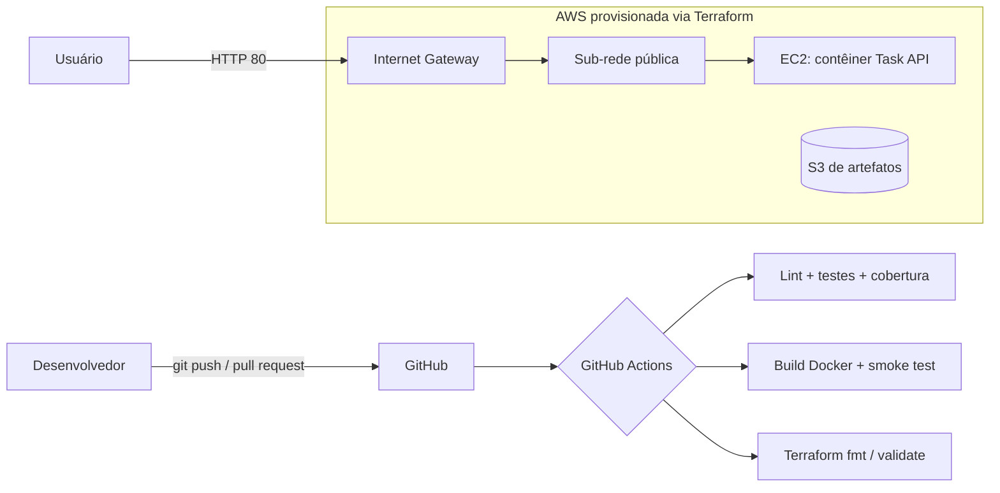

# Arquitetura

## Recursos Terraform

| Recurso                                   | Finalidade                                            |
|-------------------------------------------|-------------------------------------------------------|
| `aws_vpc`                                 | Rede privada isolada (10.0.0.0/16)                    |
| `aws_subnet`                              | Sub-rede pública (10.0.1.0/24)                        |
| `aws_internet_gateway` / `aws_route_table`| Saída e entrada de tráfego da Internet                |
| `aws_security_group`                      | HTTP (80) público; SSH (22) só se `allowed_ssh_cidr`  |
| `aws_instance`                            | Servidor que roda a aplicação em contêiner            |
| `aws_s3_bucket` (+ versioning, SSE, block)| Armazenamento de artefatos, seguro por padrão         |

## Decisões de segurança

- IMDSv2 obrigatório na EC2 e disco raiz criptografado.
- SSH desativado por padrão; quando ativado, restrito a um único CIDR.
- Bucket S3 com versionamento, criptografia AES-256 e bloqueio total de acesso público.
- Contêiner executa com usuário sem privilégios.
