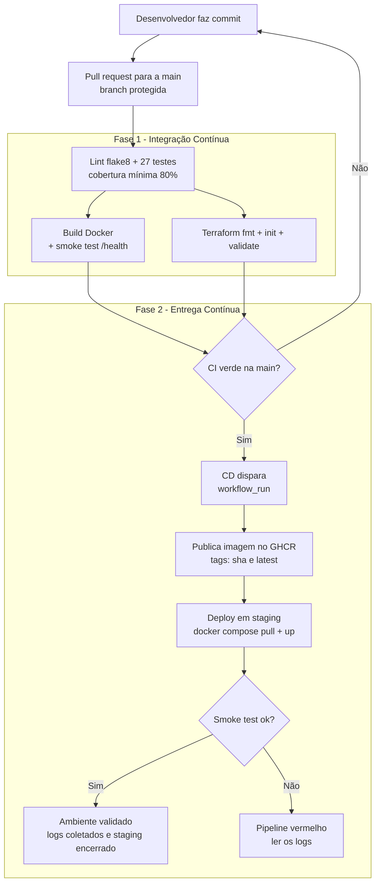

# Fluxo DevOps completo (Fases 1 e 2)

Imagem usada no relatório: [`fluxograma-devops.png`](fluxograma-devops.png).

## Etapas do CD

| Etapa | Onde | O que faz |
|-------|------|-----------|
| Gatilho | `.github/workflows/cd.yml` | Roda após o workflow **CI** terminar com sucesso na `main` (ou manualmente) |
| Publicar imagem | job `publish-image` | Constrói a imagem e publica no GitHub Container Registry com as tags `sha` e `latest` |
| Deploy em staging | job `deploy-staging` | Baixa a imagem publicada e sobe com `docker compose` (`scripts/deploy.sh`) |
| Verificação | `scripts/deploy.sh` | Espera o `/health` e cria e lista uma tarefa (smoke test) |
| Encerramento | job `deploy-staging` | Coleta os logs e derruba o ambiente, mesmo se houver falha |
